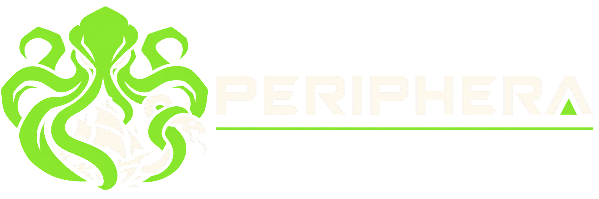
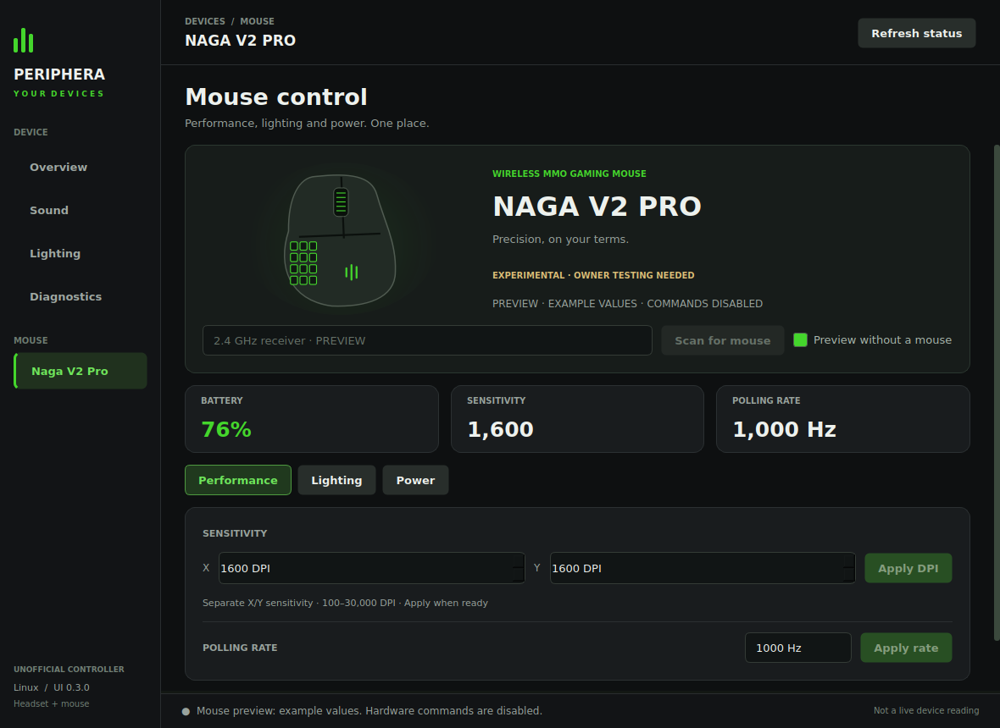
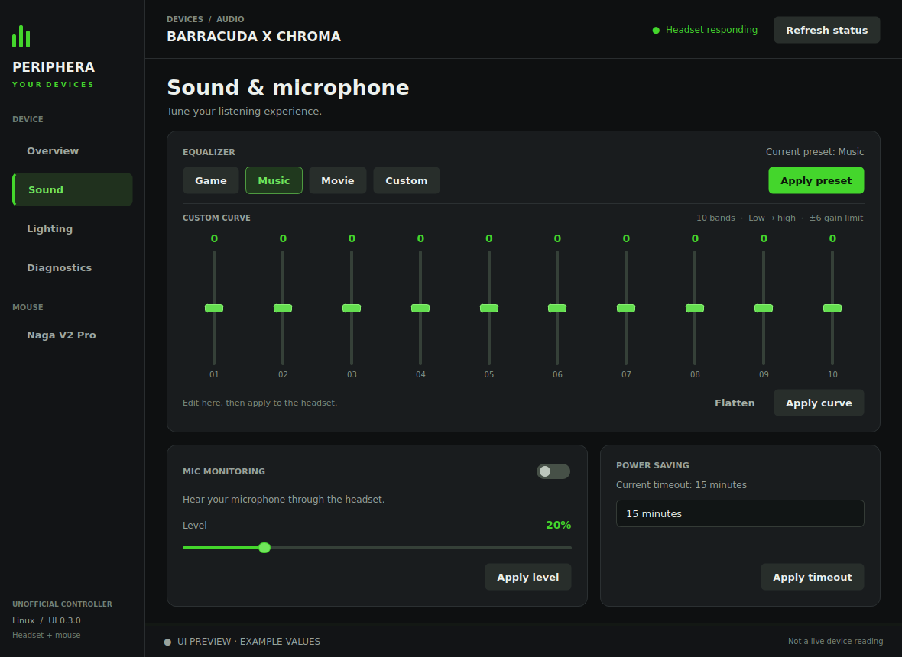
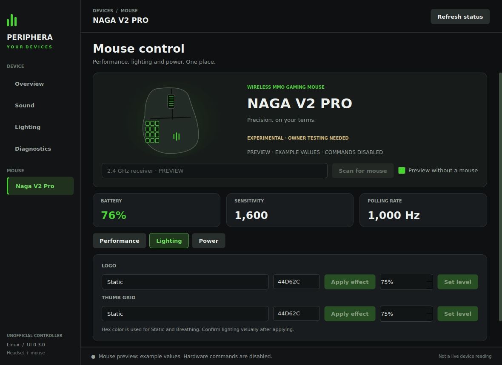
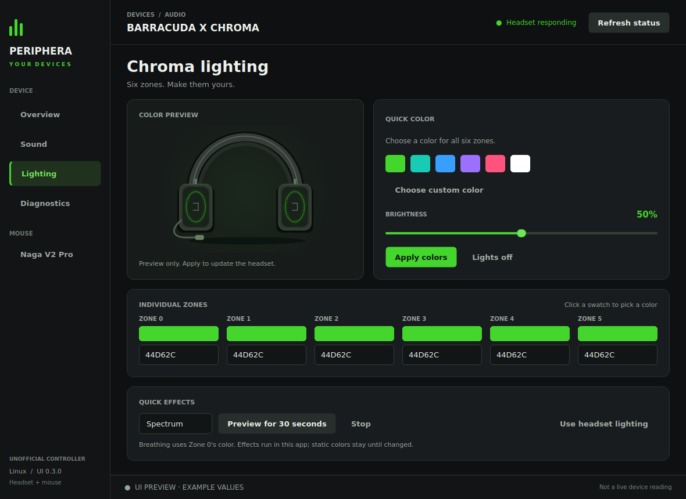
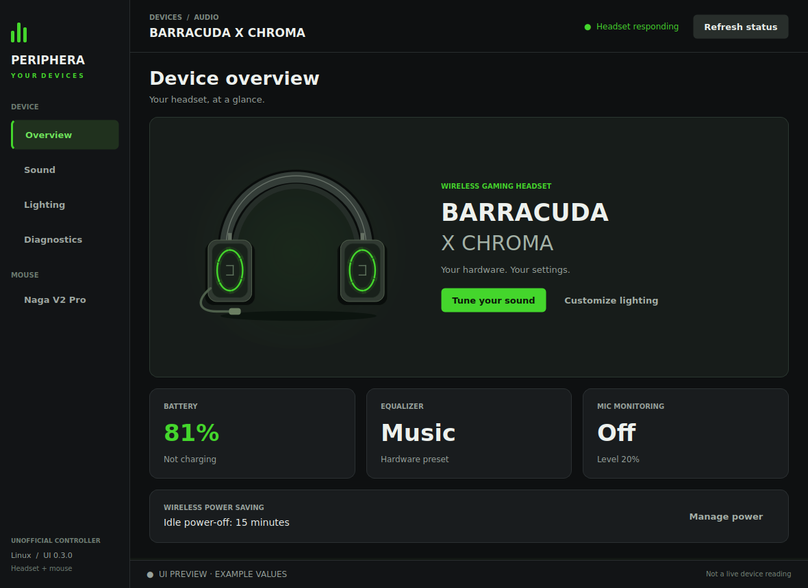
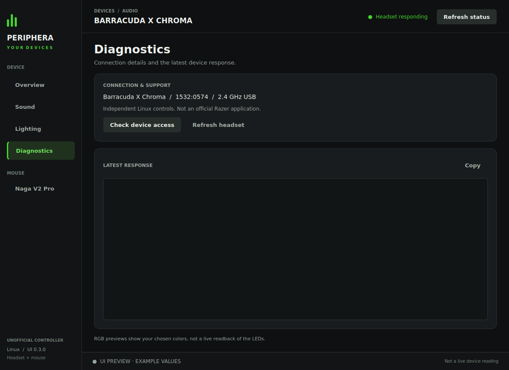
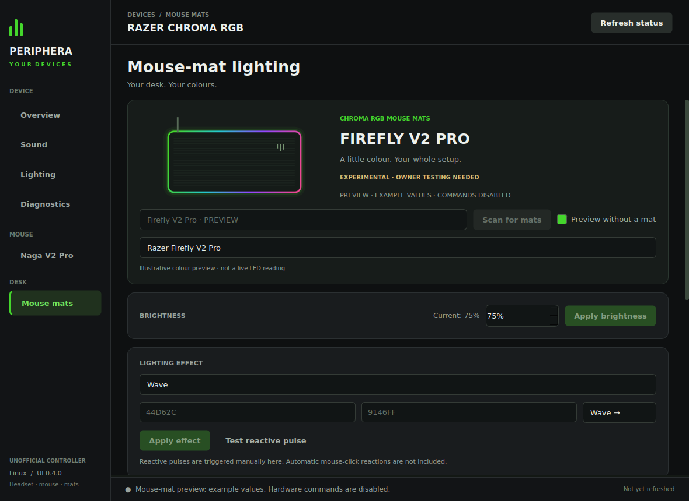

<p align="center">
  
</p>

<h1 align="center">Periphera</h1>

<p align="center">
  <strong>Your headset. Your mouse. Your desk. Your control.</strong><br>
  Open-source peripheral control for Linux, with a charcoal-and-green desktop interface.
</p>

<p align="center">
  
  <a href="https://github.com/AUSSIEbattler96-AI/Periphera/releases"></a>
  <a href="LICENSE"></a>
</p>

<p align="center">
  <a href="https://github.com/AUSSIEbattler96-AI/Periphera/releases"><strong>Download</strong></a> ·
  <a href="#what-you-can-control">Features</a> ·
  <a href="#a-look-inside">Screenshots</a> ·
  <a href="#get-started">Get started</a> ·
  <a href="docs/HOST_SETUP.md">Host setup</a> ·
  <a href="docs/SUPPORT.md">Support</a>
</p>

---

Periphera brings the **Razer Barracuda X Chroma** headset, **Razer Naga V2 Pro**
mouse and **eight Razer RGB mouse-mat models** into one Linux desktop app:
sound, lighting, performance and power settings, with explicit Apply actions
and hardware-free mouse and mouse-mat previews.

**Version: 0.4.0 · Experimental prerelease.** Mouse-mat support is included
in this version; install the matching bundle from GitHub Releases.

| Device | Connection and backend | Validation |
| --- | --- | --- |
| **Barracuda X Chroma** | 2.4 GHz dongle · direct HID | Owner-confirmed status, RGB, EQ preset switching and sidetone |
| **Naga V2 Pro** | USB cable or original receiver · host OpenRazer daemon | Experimental adapter; simulated tests only, physical hardware testing outstanding |
| **Mouse mats** | USB · host OpenRazer daemon | All eight upstream-supported models; simulated tests only, physical owner testing outstanding |

> This is an independent project, not an official Razer application or full
> Synapse compatibility. Preview values are examples, not live device readings.

## What you can control

| Area | Barracuda X Chroma | Naga V2 Pro | RGB mouse mats |
| --- | --- | --- | --- |
| **Sound** | EQ and microphone monitoring / sidetone | — | — |
| **Performance** | — | DPI and polling rate | — |
| **Lighting** | Six-zone RGB | Separate logo and thumb-grid lighting | Brightness, static/spectrum/breathing/off, supported wave/reactive effects and custom colours |
| **Power** | Battery/status and power saving | Battery and power settings | — |

Capability detection and diagnostic responses help show what the connected
backend supports. Mouse and mouse-mat previews let you explore the interface
without connecting hardware or installing OpenRazer; **preview mode cannot send commands**.

### RGB mouse mats

| Model | USB ID |
| --- | --- |
| Firefly (including editions using this ID) | `1532:0c00` |
| Firefly HyperFlux | `1532:0068` |
| Firefly V2 | `1532:0c04` |
| Firefly V2 Pro | `1532:0c08` |
| Goliathus Chroma | `1532:0c01` |
| Goliathus Extended Chroma | `1532:0c02` |
| Goliathus Chroma 3XL | `1532:0c06` |
| Strider Chroma | `1532:0c05` |

Select **Mouse mats** in the sidebar, click **Scan for mats**, then choose
your device. Effects follow the installed driver's capabilities; wave is
not offered for the single-colour Goliathus family or Firefly HyperFlux.
Custom colours use the live driver's matrix layout. See the
[mouse-mat guide](docs/MOUSE_MATS.md) for setup, variants and limitations.

See [support details](docs/SUPPORT.md) for the exact boundaries and missing features.

## A look inside

| Mouse · Performance | Headset · Sound |
| :---: | :---: |
|  |  |
| **Mouse · Lighting** | **Headset · Lighting** |
|  |  |

<details>
<summary>More screens: overview and diagnostics</summary>





</details>



## Get started

### Install the Flatpak

Download `periphera.flatpak` from [GitHub Releases](https://github.com/AUSSIEbattler96-AI/Periphera/releases).
Install Flatpak using your distribution's package manager, then run:

```sh
flatpak install --user ./periphera.flatpak
flatpak run io.github.AUSSIEbattler96_AI.Periphera
```

You can also launch **Periphera** from your desktop menu.

The release is a standalone GitHub-distributed bundle. To update, download and
install the newer bundle. It is not a Flathub listing or an automatic-update
repository.

### Set up the host

Follow [HOST_SETUP.md](docs/HOST_SETUP.md) for headset permissions and
**OpenRazer 3.10.3+** for Naga control and a current OpenRazer release for mouse mats. Host drivers cannot be installed inside
the Flatpak. Existing headset users can keep their current udev rule.

| Device | Supported connection | USB ID |
| --- | --- | --- |
| Barracuda X Chroma | 2.4 GHz dongle | `1532:0574` |
| Naga V2 Pro | USB cable | `1532:00a7` |
| Naga V2 Pro | Original receiver | `1532:00a8` |

Bluetooth and Mouse Dock Pro configuration are not supported.

The Flatpak requests broad device access for headset hidraw and a narrowly
named D-Bus permission for OpenRazer. It requests no network or home-directory
access.

### Try the device previews

Select **Naga V2 Pro** in the sidebar and enable **Preview without a mouse**.
No mouse or OpenRazer installation is required to explore this read-only mode.

For mats, select **Mouse mats**, enable **Preview without a mat**, and
choose any of the eight models from the preview list. All Apply buttons are disabled.

### Run or update a native installation

For an existing installation, close the GUI and replace the files in your
`barracuda-linux` directory with the new source archive. Your installed
`python-pyqt6` package and headset udev rule remain suitable. Launch as before:

```sh
python3 barracuda.py gui
```

For a new native installation on Arch/CachyOS, install `python-pyqt6` first.
Other distributions may package `PyQt6.QtDBus` separately.

The headset CLI still needs only Python's standard library.
See the [headset CLI guide](docs/HEADSET_CLI.md).

## Build and develop

On a Linux desktop with Flatpak and flatpak-builder installed:

```sh
bash scripts/build-flatpak.sh
```

The script installs the **KDE 6.10 SDK/runtime and PyQt BaseApp** into your
user Flatpak installation, runs the tests inside the SDK, and creates:

- `dist/periphera.flatpak`
- `dist/SHA256SUMS`

It does not install host drivers, write udev rules or change device settings.
The first build downloads the SDK and can take a while. The GitHub workflow
builds **x86_64**; other architectures have not been validated.

Run the backend and GUI tests directly with:

```sh
QT_QPA_PLATFORM=offscreen python3 -m unittest discover -v
```

### Validation and releases

The **Test and build Flatpak** workflow runs on `main`, pull requests, tags and
manual dispatch. It checks backend/UI tests, real D-Bus wire types against a
simulated service, desktop metadata, the Flatpak build and the installed app,
then uploads a downloadable artifact.

The [first successful build](https://github.com/AUSSIEbattler96-AI/Periphera/actions/runs/40892218019)
passed all **65 tests** on Ubuntu and inside the Flatpak SDK, the simulated
D-Bus integration test, metadata validation and an installation/startup check.
The 0.4.0 update adds mouse-mat controller/UI tests and a byte-array matrix
case to the simulated D-Bus integration check. Physical Naga V2 Pro and
mouse-mat testing is still outstanding. Read
[VALIDATION.txt](VALIDATION.txt) and [SUPPORT.md](docs/SUPPORT.md) for what was
actually tested.

Release tags use the `v0.3.0` format. After the workflow is green, a successful
tag build creates a **draft prerelease** with the Flatpak, source ZIP, host setup
files and checksums. Review the draft in GitHub Releases before publishing.

An explicit release request can also be committed in `.github/release.json`
with `tag`, `publish` and `prerelease` fields. The tag must match `UI_VERSION`.
Only a main-branch push that changes that file can use its publication flags;
ordinary pushes, pull requests and manual main builds do not publish it.
The release job waits for the tests, Flatpak build and installation/startup
checks, verifies every download against `SHA256SUMS`, then creates the release
at the exact tested commit. Setting `publish` to true publishes the assets;
setting it to false leaves a draft.

## License and acknowledgements

Licensed under [GPL-3.0-or-later](LICENSE), compatible with the GPL edition of
PyQt6 used by this package. OpenRazer is a separate host dependency.

Razer, Barracuda, Naga, Firefly, Goliathus, Strider and Chroma are trademarks of their respective owner.
Periphera is not affiliated with or endorsed by Razer.
