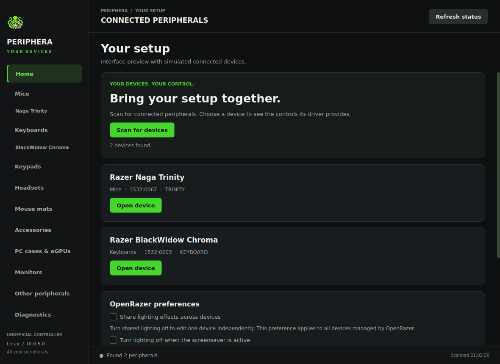
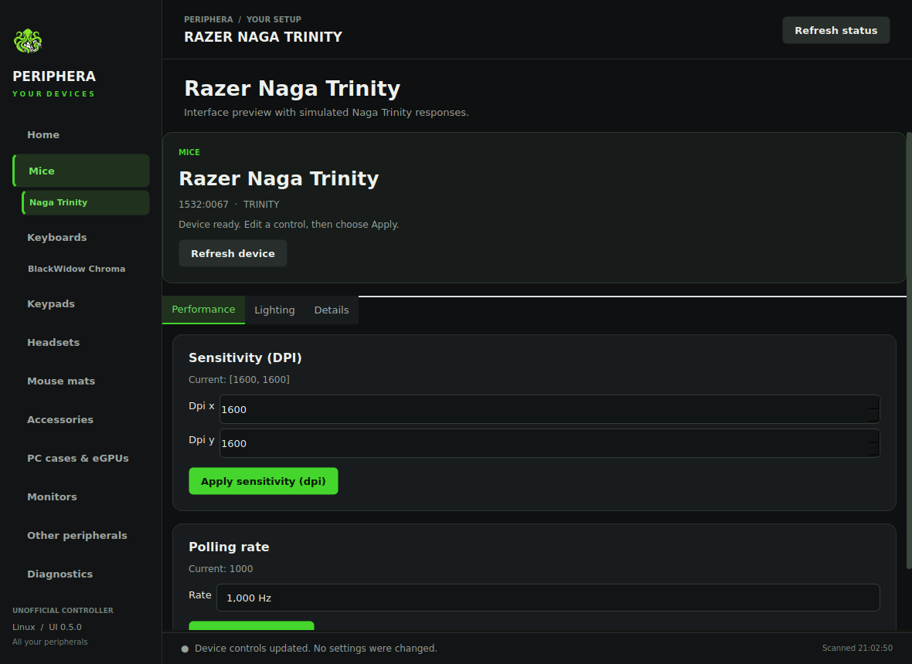

<p align="center">
  
</p>

<h1 align="center">Periphera</h1>

<p align="center">
  <strong>Your peripherals. Your setup. Your control.</strong><br>
  Open-source peripheral control for Linux, with a charcoal-and-green desktop interface.
</p>

<p align="center">
  
  <a href="https://github.com/AUSSIEbattler96-AI/Periphera/releases"></a>
  <a href="LICENSE"></a>
</p>

<p align="center">
  <a href="https://github.com/AUSSIEbattler96-AI/Periphera/releases"><strong>Download</strong></a> ·
  <a href="#what-you-can-control">Features</a> ·
  <a href="#a-look-inside">Screenshots</a> ·
  <a href="#get-started">Get started</a> ·
  <a href="docs/HOST_SETUP.md">Host setup</a> ·
  <a href="docs/SUPPORT.md">Support</a>
</p>

---

Periphera brings **all peripherals reported by your host OpenRazer daemon**
into one Venom-green Linux desktop app, alongside its direct **Barracuda X
Chroma** headset backend. That includes the **Naga Trinity**, other supported
mice, keyboards, keypads, headsets, mouse mats, cases, monitors and accessories.

**Version: 0.5.0 · Experimental prerelease.**

### Scan. Select. Make it yours.

1. Open **Home** and choose **Scan for devices**.
2. Connected devices appear under their peripheral type in the sidebar.
3. Select a device to load the controls its installed driver actually exposes.
4. Edit a setting and choose **Apply**. Scanning, navigation and editing drafts
   never apply settings automatically.

The sidebar has one entry per peripheral type, with individual devices beneath
it. It does not list a catalogue of unconnected models or separate control modules.
Duplicate model names are distinguished by their device identifiers. Rescanning
removes disconnected devices and invalidates stale control pages.

## What you can control

| Area | Controls shown when the device supports them |
| --- | --- |
| **Lighting** | Zone brightness and enable state; static, spectrum, breathing, wave, wheel, reactive, starlight, blinking and ripple effects |
| **Custom colours** | Individual RGB colours across the live driver's complete multi-row LED matrix |
| **Performance** | DPI, discrete legacy sensitivity options, DPI stages and supported polling rates |
| **Scroll** | Tactile/free-spin mode, acceleration and Smart Reel where OpenRazer exposes them |
| **Power** | Battery and charging status, idle timeout, low-battery warning and charging lighting |
| **Keys & macros** | Gaming/macro modes, profile LEDs, key-switch optimisation and macro sequences with key, URL and host-script actions |
| **Accessories** | Supported ARGB channel brightness/LED counts, charging zones, Kraken colour/intensity and HyperPolling controls |
| **Host preferences** | Explicit shared-lighting and screensaver-lighting preferences |
| **Barracuda X Chroma** | Existing EQ, microphone monitoring, power saving and six-zone lighting through its direct HID backend |

**Device discovery is not restricted to a hardcoded product list.** A newer
OpenRazer-supported device can appear without a Periphera model update. Controls
are offered only when their documented method and signature are advertised by
the selected device. Future API features may still need an app update.

> Hardware support depends on the OpenRazer version installed on your host and
> the device's connection mode. This is an independent project, not an official
> Razer application or full Synapse compatibility. Generic integration is tested
> with simulated devices; physical owner testing remains outstanding.

OpenRazer's lighting synchronization must be off before editing one device's
lighting. You can change that preference explicitly on **Home**. Commands are
revalidated against the selected device before sending, and diagnostic output
records the response. Daemon readback may be cached; confirm changes physically.

Hardware-free mouse and mouse-mat previews remain available from **Home**.
Preview values are examples and **preview mode cannot send commands**.
See [support details](docs/SUPPORT.md) and the [mouse-mat guide](docs/MOUSE_MATS.md).

## A look inside

| Home · Device discovery | Naga Trinity · Performance |
| :---: | :---: |
|  |  |

These 0.5.0 interface previews use simulated device responses. The specialist
headset controls and hardware-free previews are shown below.

| Mouse · Performance | Headset · Sound |
| :---: | :---: |
|  |  |
| **Mouse · Lighting** | **Headset · Lighting** |
|  |  |

<details>
<summary>More screens: overview and diagnostics</summary>


</details>


## Get started

### Install the Flatpak

Download `periphera.flatpak` from [GitHub Releases](https://github.com/AUSSIEbattler96-AI/Periphera/releases).
Install Flatpak using your distribution's package manager, then run:

```sh
flatpak install --user ./periphera.flatpak
flatpak run io.github.AUSSIEbattler96_AI.Periphera
```

You can also launch **Periphera** from your desktop menu.

The release is a standalone GitHub-distributed bundle. To update, download and
install the newer bundle. It is not a Flathub listing or an automatic-update
repository.

### Steam Deck: if Discover gets stuck

In Desktop Mode, cancel the stalled install and close Discover. Open Konsole
and install the downloaded bundle with visible progress and diagnostic output:

```sh
flatpak --verbose install --user --bundle ~/Downloads/periphera.flatpak
```

Adjust the filename if your browser saved a differently named copy. The first
installation may also download the KDE runtime; the app bundle does not include
that dependency. Answer the prompts shown in Konsole. If it also stalls, keep
the last output lines: they distinguish a runtime download, a transaction lock
and an actual installation error. This is a diagnostic alternative to Discover,
not a confirmed fix for every Steam Deck installation stall.

### Set up the host

Follow [HOST_SETUP.md](docs/HOST_SETUP.md) for **OpenRazer 3.10.3+ on the host**
and the Barracuda headset's permissions. Install a newer OpenRazer release if
your peripheral was added after 3.10.3. Host kernel drivers cannot be installed
inside the Flatpak. Existing Barracuda users can keep their current udev rule.

The Naga Trinity (`1532:0067`) is included through generic discovery. USB,
receiver, Bluetooth and dock visibility follow the installed OpenRazer driver;
Periphera does not add support for connections the host driver cannot expose.

The Flatpak requests broad device access for headset hidraw and a narrowly
named D-Bus permission for OpenRazer. It requests no network or home-directory
access.

### Try the device previews

On **Home**, choose **Mouse preview** or **Mouse-mat previews**. No hardware
or OpenRazer installation is required. The mouse-mat preview offers all eight
previously included models. Apply buttons are disabled in preview mode.

### Run or update a native installation

For an existing installation, close the GUI and replace the files in your
`barracuda-linux` directory with the new source archive. Your installed
`python-pyqt6` package and headset udev rule remain suitable. Install
`python-jeepney` as the additional dependency for generic OpenRazer control. Launch as before:

```sh
python3 barracuda.py gui
```

For a new native installation on Arch/CachyOS, install `python-pyqt6` and
`python-jeepney` first. For a Python virtual environment, use
`python3 -m pip install -r requirements.txt`.
Other distributions may package `PyQt6.QtDBus` separately.

The headset CLI still needs only Python's standard library.
See the [headset CLI guide](docs/HEADSET_CLI.md).

## Build and develop

On a Linux desktop with Flatpak and flatpak-builder installed:

```sh
bash scripts/build-flatpak.sh
```

The script installs the **KDE 6.10 SDK/runtime and PyQt BaseApp** into your
user Flatpak installation, runs the tests inside the SDK, and creates:

- `dist/periphera.flatpak`
- `dist/SHA256SUMS`

It does not install host drivers, write udev rules or change device settings.
The first build downloads the SDK and can take a while. The GitHub workflow
builds **x86_64**; other architectures have not been validated.

Run the backend and GUI tests directly with:

```sh
QT_QPA_PLATFORM=offscreen python3 -m unittest discover -v
```

### Validation and releases

The **Test and build Flatpak** workflow runs on `main`, pull requests, tags and
manual dispatch. It checks backend/UI tests, real D-Bus wire types against a
simulated service, desktop metadata, the Flatpak build and the installed app,
then uploads a downloadable artifact.

The 0.5.0 suite covers generic device discovery, all peripheral types, Trinity
controls, live capability filtering, mixed devices, disconnection, lighting-sync
guards, multi-row LED uploads and typed DPI-stage/macro payloads. CI also exercises
real D-Bus messages against a simulated service. Read [VALIDATION.txt](VALIDATION.txt)
and [SUPPORT.md](docs/SUPPORT.md) for the distinction between simulated validation
and physical owner testing.

Release tags use the `v0.3.0` format. After the workflow is green, a successful
tag build creates a **draft prerelease** with the Flatpak, source ZIP, host setup
files and checksums. Review the draft in GitHub Releases before publishing.

An explicit release request can also be committed in `.github/release.json`
with `tag`, `publish` and `prerelease` fields. The tag must match `UI_VERSION`.
Only a main-branch push that changes that file can use its publication flags;
ordinary pushes, pull requests and manual main builds do not publish it.
The release job waits for the tests, Flatpak build and installation/startup
checks, verifies every download against `SHA256SUMS`, then creates the release
at the exact tested commit. Setting `publish` to true publishes the assets;
setting it to false leaves a draft.

## License and acknowledgements

Licensed under [GPL-3.0-or-later](LICENSE), compatible with the GPL edition of
PyQt6 used by this package. OpenRazer is a separate host dependency.
The Flatpak bundles Jeepney (MIT licensed) for D-Bus communication. Public API
metadata in `openrazer_catalog.json` records the exact upstream source commit.

Razer, Barracuda, Naga, Firefly, Goliathus, Strider and Chroma are trademarks of their respective owner.
Periphera is not affiliated with or endorsed by Razer.
